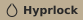

[](https://git.io/typing-svg)

<p align="center">
  
  
  
</p>
<p align="center">
  
  
  
</p>
<p align="center">
  
  
  
</p>

> [!TIP]
> Check out [MyFetch](https://github.com/elifouts/MyFetch) now!

My **Arch** Linux dotfiles for a clean, lightweight **Hyprland** setup built around **Quickshell**.

Claude helped with some of the scripting and docs. The design, look, and tweaking are all mine.

***ENJOY!!***

-Eli F.


> [!WARNING]
> Everything is designed to work with `Pywal`.
>
> <details>
>   <summary><picture></picture></summary>
>
>   Don't want `Pywal`? Pick a fixed color scheme in **Settings → Colors**, or replace the colors in an app's `style.css`. I highly recommend `Pywal` though!
>
> </details>

<p align="center">
  
</p>

# Install

<details>
  <summary><picture></picture></summary>

  ```
  cd && git clone https://github.com/elifouts/Dotfiles.git
  cd ~/Dotfiles/InstallScripts
  chmod +x install.sh
  ./install.sh
  ```

  - `1. Full install`: everything.
  - `2. Waybar` or `3. Quickshell bar`: just a bar, no other dotfiles needed.

  Nothing gets deleted. It offers to back up `~/.config` first, and anything it replaces is moved to `~/.dotfiles_replaced_<date>`. Configs are symlinked to `~/Dotfiles`, so `git pull` updates them.
</details>

<details>
  <summary><picture></picture></summary>

  Lists installed packages with their source and size.

  ```bash
  ~/Dotfiles/.config/hypr/utilities/package-tui.sh
  ```

  `j`/`k` scroll, `d` uninstall, `r` reinstall, `q` quit.
</details>

## Styles, Variants & Profiles

<details>
  <summary><picture></picture></summary>

  - **Style**: the whole look. Right now there is one: `Modern`.
  - **Variant**: `desktop` or `laptop` (monitors, input, defaults).
  - **Profile**: your tweaks on top, picked in the settings panel. **Glass** and **Zen** are mine. A saved profile also remembers your colors, bar and wallpaper.

  

  ```
  hypr/
    Modern/                 <- a style
      base/                 <- shared hyprland config
      laptop/  desktop/     <- variants
      utilities/            <- quickshells
      waybar/<name>/        <- waybar styles
      quickshellbar/<name>/ <- quickshell bar styles
    tweaks/                 <- your tweaks and saved profiles
  ```
</details>

## My Applications

Screenshots are shown as **Default** | **Glass** | **Zen**.

<details>
  <summary><picture></picture></summary>

  All of my widgets are [Quickshell](https://quickshell.org) shells. They follow your `Pywal` colors and open on the monitor you're using.

  ### *How To Install*
  1. `yay -S quickshell`
  2. Copy `Dotfiles/.config/hypr` into `~/.config` (or use the installer)
  3. `~/.config/hypr/utilities/shells.sh start` (already in `startup.lua`)
</details>

<details>
<summary><picture></picture></summary>


**Tap `Super`**. Session dial, app search, commands and a list of every keybind.
</details>

<details>
<summary><picture></picture></summary>


**`Alt+Tab`**. Clock, music, calendar, system stats, volume and notifications.
</details>

<details>
<summary><picture></picture></summary>


**`Alt+S`**. Change profiles, bar, colors, windows, effects, animations, input and more. Everything applies live.

- Save a profile in **Profile → Saved profiles**.
- **Right-click** any setting to reset it.
</details>

<details>
<summary><picture></picture></summary>


**`Alt+Enter`**. Controls Spotify or whatever is playing, with a `cava` visualizer.
</details>

<details>
<summary><picture></picture></summary>
  


**`Alt+W`**. A carousel of `~/wallpapers/library`. Picking one updates the `Pywal` colors everywhere.
</details>

<details>
<summary><picture></picture></summary>


Pops up for volume, brightness, caps lock and media keys.
</details>

<details>
<summary><picture></picture></summary>


Popups in the bottom left. History is on the home screen.
</details>

<details>
<summary><picture></picture></summary>


Plays when Hyprland starts. Turn it off in **Settings → System**.
</details>

<details>
  <summary><picture></picture></summary>

  
  
  

  A minimal Waybar with 4 styles (`default`, `experimental`, `line`, `zen`). Hover to expand hidden widgets. Pick a style in **Settings → Profile**, `Alt+A` reloads it.

  ### *How To Install*
  Run `InstallScripts/install.sh` → `2. Waybar`.

  Needs `waybar hyprpicker pywal blueman bluez networkmanager`.
</details>

<details>
  <summary><picture></picture></summary>

  
  
  
  
  

  

  A Quickshell bar with 5 styles (`default`, `attached`, `experimental`, `full`, `zen`). Its pills grow into cards for workspaces, media, network, sound and power (inspired by [NabyScape](https://github.com/BillyNabil/nabyscape)). Pick a style in **Settings → Profile**, `Alt+A` toggles it.

  ### *How To Install*
  Run `InstallScripts/install.sh` → `3. Quickshell bar`, then start it with `qs -c dotfiles-bar`.
</details>

<details>
  <summary><picture></picture></summary>

  **`Mod+L`**, or after being idle. Blurs your wallpaper and shows a music card when something is playing.

  ### *How To Install*
  1. Install [Quickshell](https://quickshell.org/) and `hypridle`
  2. Copy `.config/hypr/Modern/utilities/lock` to `~/.config/hypr/utilities/lock`, plus `utilities/lock.sh` and `hypridle.conf`
</details>

<details>
  <summary><picture></picture></summary>


A lightweight Lazy setup with only the plugins I want, themed with `Pywal`. Relaunch it after changing wallpaper to load new colors.

### *How To Install*
1. `yay -S neovim`
2. Copy `Dotfiles/.config/nvim` into `~/.config/`
3. Start `nvim` and it installs everything.
</details>

<details>
  <summary><picture></picture></summary>
  

A minimal prompt with everything you need.

### *How To Install*
1. Install [Starship](https://github.com/starship/starship?tab=readme-ov-file#-installation)
2. Copy `Dotfiles/.config/starship.toml` into `~/.config`
3. Add `eval "$(starship init bash)"` to your `.bashrc` ([other shells](https://github.com/starship/starship?tab=readme-ov-file#step-2-set-up-your-shell-to-use-starship))
</details>

<details>
  <summary><picture></picture></summary>
  

Makes Firefox use your `Pywal` colors.

### *How To Install*
1. Install [Pywalfox](https://github.com/Frewacom/pywalfox) and run `pywalfox install`
2. Install the Pywalfox Firefox add-on
3. Run `pywalfox update` after changing colors
</details>

<details>
  <summary><picture></picture></summary>

  - Widgets: Materia-dark
  - Icons: Qogir-dark
  - Cursor: Bibata-Modern-Ice
</details>

<details>
  <summary><picture></picture></summary>

  Replaced by the Quickshell utilities. Configs are still in `archive/`.

<details>
  <summary><picture></picture></summary>
    

  To blur Wofi:

  ```
  layerrule = blur, wofi
  layerrule = ignorezero, wofi
  layerrule = ignorealpha 0.5, wofi
  ```
</details>

<details>
  <summary><picture></picture></summary>
  

  Config is in `archive/swaync`.
</details>

<details>
  <summary><picture></picture></summary>

  Config is in `archive/swayosd`.
</details>

<details>
  <summary><picture></picture></summary>
  

  Config is in `archive/wlogout`.
</details>

<details>
  <summary><picture></picture></summary>
  

  

  

  Replaced by the Quickshell lock screen. Config is in `archive/hyprlock`.
</details>

<details>
  <summary><picture></picture></summary>

  

  Wofi + `swww` + `Pywal`.
</details>

</details>

<details>
<summary><picture></picture></summary>

### Desktop Profiles

<p align="center">
  
  
  
</p>

### Quickshell

<p align="center">
  
  
  
</p>
<p align="center">
  
  
  
</p>
<p align="center">
  
  
  
</p>
<p align="center">
  
  
  
</p>
<p align="center">
  
  
  
</p>
<p align="center">
  
  
  
</p>
<p align="center">
  
  
  
</p>
<p align="center">
  
  
  
</p>

### Waybar

<p align="center">
  
  
  
</p>

<p align="center">
  
  
  
  
  
  
  
</p>

### Quickshell Bar

<p align="center">
  
  
  
  
  
</p>

<p align="center">
  
  
</p>

### Other Applications

**Neovim**

<p align="center">
  
  
  
</p>
<p align="center">
  
  
  
</p>

**Starship**

<p align="center">
  
  
  
</p>
<p align="center">
  
  
  
</p>

**Pywalfox**

<p align="center">
  
  
  
</p>
<p align="center">
  
  
  
  
</p>

**Wofi**

<p align="center">
  
  
  
  
</p>

**Swaync**

<p align="center">
  
  
  
  
</p>

**Wlogout**

<p align="center">
  
  
  
  
</p>

**Hyprlock**

<p align="center">
  
  
  
</p>
<p align="center">
  
</p>
<p align="center">
  
  
  
  
</p>

### GIFs

<table>
  <tr>
    <td align="center" width="33%">
      
    </td>
    <td align="center" width="33%">
      
    </td>
    <td align="center" width="33%">
      
    </td>
  </tr>
  <tr>
    <td align="center" width="33%">
      
    </td>
    <td align="center" width="33%">
      
    </td>
    <td align="center" width="33%">
      
    </td>
  </tr>
  <tr>
    <td align="center" width="33%">
      
    </td>
    <td align="center" width="33%">
      
    </td>
    <td align="center" width="33%">
      
    </td>
  </tr>
</table>

</details>

## Keybinds

`Mod+Q` - Open Terminal

`Super` (tap) - App Launcher

`Mod+M` - Quit Hyprland

`Mod+B` - Close

`Mod+F` - Fullscreen

`Mod+V` - Popout

`Mod+L` - Lock

`Mod+Space` - Terminal Scratch Pad

`Mod+E` - Opens Thunar

`Alt+Tab` - Home Screen

`Alt+S` - Settings Panel

`Alt+W` - Wallpaper Picker

`Alt+Enter` - Music Player

`Alt+A` - Reload Bar

> [!NOTE]
> Not every keybind. Tap `Super` → **Keybinds** to see all of them, or edit `~/.config/hypr/Modern/base/shortcuts.lua`.

## Help

<details>
  <summary><picture></picture></summary>

  Electron apps (`Spotify`, `Discord`) may need Wayland flags. Add this after the `Exec=` command in `/usr/share/applications/{app}.desktop`:

  ```
  --enable-features=UseOzonePlatform --ozone-platform=wayland --uri=%U
  ```

  This gets reset when the app updates. Know a better fix? Let me know!
</details>

<details>
  <summary><picture></picture></summary>

  Files like `/home/eli/.cache/wal/colors-waybar.css` are made by `Pywal`. Replace `eli` with your username, or define the colors yourself in the `style.css`:

  ```
  @define-color background <Color>;
  @define-color color0 <Color>;
  ```
</details>

## Notes
- Cava follows `Pywal` too. The config is in `.config/cava`.
<details>
  <summary><picture></picture></summary>

  What I install on a new machine. Do your own research before installing all of it!

```txt
git
quickshell
nvim
zip unzip
pipewire
hyprpicker
hypridle
hyprshot
pyprland
code
bottom
myfetch
yay
wl-clipboard
nerd-fonts
starship
thunar
grim
slurp
gnome-network-displays
discord
Firefox
spotify ncspot
pacman-contrib
python-pywal16
waybar
awww
blueman
bluez
networkmanager
gvfs
libnotify
pavucontrol
pipewire-pulse
nwg-look
cava
python-pywalfox
auto-cpufreq
powertop
qogir-icon-theme
fd
noto-fonts
libreoffice-fresh
materia-dark-gtk
```

  Fun to have

  ```
  asciiquarium
  pipes-rs
  clock-rs
  libcaca
  cowsay
  snake
  2048
  terminal-mines mines-tui
  genact
  no-more-secrets
  lolcat
  ```
  Cool things you don't need
  ```
  waypaper
  ranger
  howdoi
  ```
</details>
