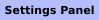
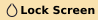
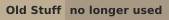
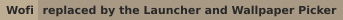
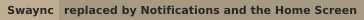

[](https://git.io/typing-svg)

<p align="center">
  
  
  
</p>
<p align="center">
  
  
  
</p>
<p align="center">
  
  
  
</p>

 
<details>
  <summary><picture></picture></summary>
  <br>
  
</details>

<details>
<summary><picture></picture></summary>

### Desktop Profiles

<p align="center">
  
  
  
</p>

### Quickshell

<p align="center">
  
  
  
</p>
<p align="center">
  
  
  
</p>
<p align="center">
  
  
  
</p>
<p align="center">
  
  
  
</p>
<p align="center">
  
  
  
</p>
<p align="center">
  
  
  
</p>
<p align="center">
  
  
  
</p>
<p align="center">
  
  
  
</p>
<p align="center">
  
  
  
</p>

### Waybar

<p align="center">
  
  
  
</p>

<p align="center">
  
  
  
  
  
</p>

### Quickshell Bar

<p align="center">
  
  
  
  
  
</p>

<p align="center">
  
  
  
</p>

### Other Applications

**Neovim**

<p align="center">
  
  
  
</p>
<p align="center">
  
  
  
</p>

**Starship**

<p align="center">
  
  
  
</p>
<p align="center">
  
  
  
</p>

**Pywalfox**

<p align="center">
  
  
  
</p>
<p align="center">
  
  
  
  
</p>

**Wofi**

<p align="center">
  
  
  
  
</p>

**Swaync**

<p align="center">
  
  
  
  
</p>

**Wlogout**

<p align="center">
  
  
  
  
</p>

### GIFs

<p align="center">
  
</p>
<table>
  <tr>
    <td align="center" width="33%">
      
    </td>
    <td align="center" width="33%">
      
    </td>
    <td align="center" width="33%">
      
    </td>
  </tr>
  <tr>
    <td align="center" width="33%">
      
    </td>
    <td align="center" width="33%">
      
    </td>
    <td align="center" width="33%">
      
    </td>
  </tr>
  <tr>
    <td align="center" width="33%">
      
    </td>
    <td align="center" width="33%">
      
    </td>
    <td align="center" width="33%">
      
    </td>
  </tr>
  <tr>
    <td align="center" width="33%">
      
    </td>
    <td align="center" width="33%">
      
    </td>
  </tr>
</table>

### Older Screenshots

**Hyprlock**

<p align="center">
  
  
  
  
</p>

**Old Wallpaper Picker**

<p align="center">
  
  
</p>

</details>

> [!TIP]
> Check out [MyFetch](https://github.com/elifouts/MyFetch) now!

This contains My **Arch** Linux Dotfiles for a clean-looking lightweight **Hyprland** setup, built around **Quickshell**.

Built by me, with help from my own thoughts and ideas AKA Claude for some of the scripting and docs. The design, look, and tweaking are all mine.

***ENJOY!!***

-Eli F.


> [!WARNING]
> All configurations are designed to work with `Pywal`.
>
> <details>
>   <summary><picture></picture></summary>
>
>   If you don't want to use `Pywal`, you can select a fixed color scheme in the settings panel (`Alt+S` → Colors), or edit the relevant application's `style.css` and replace the dynamic colors with valid fixed color values.
>
>   I highly recommend `Pywal`, though — it's pretty cool!
  
> </details>

# Install

<details>
  <summary><picture></picture></summary>
  
  ```
  cd && git clone https://github.com/elifouts/Dotfiles.git
  cd ~/Dotfiles/InstallScripts
  chmod +x install.sh
  ./install.sh
  ```  

  Pick `1. Full install` for everything, or just a bar on its own:
  - `2. Waybar`: asks for a style and copies it into `~/.config/waybar`.
  - `3. Quickshell bar`: asks for a style and installs it as its own Quickshell config (`~/.config/quickshell/dotfiles-bar`, run with `qs -c dotfiles-bar`).

  Neither needs the rest of the dotfiles, and both print the lines to add to your Hyprland config for startup and keybinds when they finish.

  ### What the full install does
  1. Asks which Hyprland style/variant you want (e.g. `Modern — desktop`).
  2. **Automatic** (installs everything) or **Manual** (asks before every package).
  3. Installs the packages, Bluetooth and PipeWire.
  4. Links the dotfiles into `~/.config` and opens the wallpaper picker.
  5. Optional: autologin, the [hyprglass](https://github.com/hyprnux/hyprglass) plugin (needed for the Glass look), extra apps, reboot.

  ### Is it safe?
  Yes. It doesn't delete anything:
  - It asks to **back up** `~/.config`, `~/.icons`, `~/wallpapers` and `~/.bashrc` first (`~/.config_backup_<date>`, ...).
  - Anything it would replace is **moved** to `~/.dotfiles_replaced_<date>`, never deleted.
  - Packages are installed with `--needed`, so nothing you already have gets reinstalled.
  - Every optional step asks first, and autologin and hyprglass both have an uninstall option.
  - The configs are **symlinked** to `~/Dotfiles`, so `git pull` updates them and your edits show up in the repo.
</details>

<details>
  <summary><picture></picture></summary>

  The package manager tool shows explicitly installed applications and packages
  from the full installer, including AUR packages, source, installed status, and
  disk size:
  
  ```bash
  cd ~/Dotfiles
  ./.config/hypr/utilities/package-tui.sh
  ```
  
  Use the arrow keys or `j`/`k` to scroll, `Enter` or `d` to uninstall, `r` to
  reinstall packages included in the full installer, and `q` to quit. For a
  non-interactive list, run `./.config/hypr/utilities/package-tui.sh --list`.
</details>

## Styles, Variants & Profiles

<details>
  <summary><picture></picture></summary>

  - **Style**: the whole look: Hyprland config, quickshells and waybars. Right now there is **one style: `Modern`**.
  - **Variant**: a machine running a style: `desktop` and `laptop`. All variants share the style's `base/` files; a variant only holds a `machine.lua` (monitors, mouse sensitivity, boot and cursor defaults), plus any base file it wants to replace.
  - **Profile**: your tweaks on top of the variant, picked in the settings panel:
    - **Default**: the variant exactly as it ships, no tweaks.
    - **Desktop / Laptop**: the variant's own tweaks file.
    - **Saved profiles**: named snapshots you make yourself. **Glass** and **Zen** are mine.

  A saved profile remembers its tweaks **plus** the color theme, waybar style and wallpaper, so switching one changes the whole look.

  

  ```
  hypr/
    Modern/                 <- a style
      base/                 <- shared by every variant: hyprland.lua, startup.lua, style.lua, shortcuts.lua, ...
      laptop/  desktop/     <- variants: machine.lua (+ any base file to replace for that machine)
      utilities/            <- the style's quickshells (common/ holds what they share)
      waybar/<name>/        <- waybar styles: config, style.css, preview.png
      quickshellbar/<name>/ <- quickshell bar styles: config.json, preview.svg
    tweaks/                 <- your tweaks and saved profiles (profiles are never edited)
    utilities/              <- shared scripts; the active style's quickshells are symlinked in here
  ```

  To add a style, copy `Modern` to `hypr/<Style>/` and restyle it. It shows up in the settings panel on its own.
</details>

## My Applications

Every screenshot below is shown three times, once for each saved profile: **Default** | **Glass** | **Zen**. The configurations are the same; only the selected profile in the settings panel changes.

<details>
  <summary><picture></picture></summary>

  All of my widgets are [Quickshell](https://quickshell.org) shells. They stay running in the background, so they open instantly, follow your `Pywal` colors and Hyprland rounding, and open on the monitor you're using.
  
  ### *How To Install*
  1. **Install [Quickshell](https://quickshell.org)** (`yay -S quickshell`)
  2. Copy `Dotfiles/.config/hypr` into `~/.config` (or use the installer)
  3. `~/.config/hypr/utilities/shells.sh start` starts them all. `startup.lua` already does this.
  4. `shells.sh <utility> [call]` opens one (`shells.sh music`, `shells.sh launcher tab apps`, ...). Every folder in `utilities/` with a `shell.qml` is loaded, so a new utility is just a new folder.
  5. A new utility is self-contained: `import "../common"` gives it the palette and Hyprland's own look and motion through `Theme` (`Theme.rounding`, the `Theme.settle`/`Theme.leave` curves, and `Theme.ms(280)` for any duration, which follows Hyprland's speed, stops when its animations are off and honors *Default quickshell animations*), plus the shared `Switch`, `Slider`, `PlayPause` and `Theme.openSpotify()`. Blur and glass are opt-in per window namespace, one line each in `style.lua` and `hyprglass.lua`.
</details>

<details>
<summary><picture></picture></summary>


- **Tap `Super`** to open it. It rises from the bottom of the screen.
- **Home**: a dial of session actions (home screen, settings, wallpaper, lock, screenshot, sleep, logout, reboot, power).
- **Apps**: a searchable app grid, sorted by what you use most.
- **Commands**: run any shell command.
- **Keybinds**: every shortcut, read live from `shortcuts.lua`.
</details>

<details>
<summary><picture></picture></summary>


- `Alt+Tab` opens a dashboard over a blurred wallpaper.
- Clock, now playing, calendar, CPU/RAM/GPU stats, volume, notification history and session buttons.
</details>

<details>
<summary><picture></picture></summary>


`Alt+S` slides it in from the left. Everything applies **live**, and your profile files are never edited.

- **Profile**: pick the style and variant, switch or save profiles, and pick the bar, **Waybar** or the **Quickshell bar**, and its style (with a preview of each layout). The quickshell bar's pills grow into workspaces, media, network, sound and session cards on hover (inspired by [NabyScape](https://github.com/BillyNabil/nabyscape)). Each style's bars live in `<style>/waybar/` and `<style>/quickshellbar/`, and a new folder there shows up in the list. `Alt+A` stops or starts whichever bar is up.
- **Colors**: a wheel of color schemes. **Pywal** (default) follows your wallpaper, and every `*.json` in `~/.config/wal/colorschemes/<dark|light>/` shows up too.
- **Windows**: gaps, borders, rounding, a gradient border, tiling, opacity.
- **Effects**: blur, shadow, glow, dimming, and every **hyprglass** option (when the plugin is installed).
- **Animations**: presets, a Bézier curve editor with a live preview, and **Randomize**.
- **Input & cursor**: mouse, touchpad, gestures, keyboard, cursor theme and size.
- **System**: boot animation, display, and **Reset tweaks**.

### Saving a custom profile
1. Tweak anything you want, including the wallpaper, colors and waybar.
2. Go to **Profile → Saved profiles**, type a name, and hit **Save** (**Overwrite** if the name is taken).
3. Click any profile to apply it. Click the trash icon twice to delete it.

### Tips
- **Right-click** any setting to put it back to the profile's value.
- Drag the right edge to resize. `Esc`, clicking outside, or `Alt+S` closes it.
- `←/→` or `h/l` change page, `↑/↓` or `j/k` scroll, `Enter` applies.
- Options that wouldn't do anything (touchpad on a desktop, blur size with blur off) are hidden.
</details>

<details>
<summary><picture></picture></summary>


- `Alt+Enter` drops a card out from under waybar.
- Follows Spotify, or whatever is playing. The chip in the top left switches players.
- Live `cava` visualizer. Drag the bottom edge to resize it.
</details>

<details>
<summary><picture></picture></summary>


- `Alt+W` opens a 3D carousel of `~/wallpapers/library`, with the palette of each wallpaper.
- `←/→` browse, `Tab` changes category, `R` picks a random one, `Enter` applies.
- Applying sets the wallpaper with `awww`, regenerates the `Pywal` colors, and updates everything that uses them.
</details>

<details>
<summary><picture></picture></summary>


- Volume, mic, brightness, caps lock and media keys pop up a pill at the bottom of the screen.
</details>

<details>
<summary><picture></picture></summary>


- Popups in the bottom left. The history lives in the home screen.
</details>

<details>
<summary><picture></picture></summary>


- Plays once when Hyprland starts. Turn it off or change the delay in **Settings → System**.
</details>


<details>
  <summary><picture></picture></summary>

  
  
  
  
  
  
  
  
  
  ## Overview
  This is my minimal Waybar setup for Hyprland, designed to be clean and efficient. There are 4 styles (`default`, `experimental`, `line`, `zen`) in `hypr/Modern/waybar/`. Pick one in **Settings → Profile → Waybar**, and `Alt+A` reloads it.

  ## Workspaces
  I’ve configured the workspaces so that if there is content on a workspace, the dot appears darker. This helps you keep track of your open content! Inspiration from [Gbar](https://github.com/scorpion-26/gBar).

  ## Expanding Waybar
  You can hide and reveal widgets you don’t need all the time. You can easily add or remove widgets in the style's `config` under the `group/expand` section.
  
  - **Network Widget**: Clicking the network widget opens `nmtui` in `kitty`.
  - **Hyprpicker Widget**: This custom widget lets you use `hyprpicker`, display values when hovered, and copy the hex value to your clipboard.

  ### Dependencies
  ```
  waybar
  hyprpicker
  pywal
  blueman
  bluez
  networkmanager
  ```

  ### *How To Install*
  Run `InstallScripts/install.sh` → *Waybar*. It works on its own, without the rest of the dotfiles.

</details>

<details>
  <summary><picture></picture></summary>

  
  
  
  
  

  
  

  ## Overview
  A Quickshell alternative to Waybar that uses your Pywal colors. There are 5 styles (`default`, `attached`, `experimental`, `full`, `zen`) in `hypr/Modern/quickshellbar/`. Pick one in **Settings → Profile → Quickshell bar**, and `Alt+A` stops or starts it.

  ## Pills
  The bar's pills grow into cards when you use them (inspired by [NabyScape](https://github.com/BillyNabil/nabyscape)):

  - **Workspaces**: a live preview of each workspace, plus the overview.
  - **Media / clock**: an island with tabs for the music player, a timer, a color picker and the weather.
  - **Network, sound, power**: Wi-Fi and Bluetooth, output and input devices, and session buttons.
  - **Tray**: right-click an app to open its menu.

  ## Making a style
  Each style is a folder with a `config.json` that lists the modules for the `left`, `center` and `right` of the bar (`|` adds a divider), plus `height`, `gap`, `shape`, `background`, `strip` and `attached`. Copy a folder, change it, and it shows up in the settings panel.

  ### *How To Install*
  Run `InstallScripts/install.sh` → *Quickshell bar*. It installs as its own Quickshell config (`~/.config/quickshell/dotfiles-bar`, run with `qs -c dotfiles-bar`), without the rest of the dotfiles.

</details>

<details>
  <summary><picture></picture></summary>
  

  
  
  ## Overview
    
  - A Quickshell lock screen (`hypr/Modern/utilities/lock`) that blurs your current wallpaper, greets you by username, and uses your Pywal colors.
  - A music card with album art and previous / play-pause / next shows whenever a player is running.
  - `Mod+L` locks (`utilities/lock.sh`). `hypridle` also locks it when you're idle (`hypridle.conf`).
  - The old Hyprlock config is kept in `archive/hyprlock/`.

  ### *How To Install*
1. **Install [Quickshell](https://quickshell.org/)** and `hypridle`
2. Copy `Dotfiles/.config/hypr/Modern/utilities/lock` to `~/.config/hypr/utilities/lock`, `utilities/lock.sh` to `~/.config/hypr/utilities/lock.sh`, and `hypridle.conf` into `~/.config/hypr`

</details>

<details>
  <summary><picture></picture></summary>

  
## Overview

- This Neovim "rice" is a simplified version of Lazyvim, created with custom Lua files. It’s lightweight and includes only what you need. I just installed lazy and configured only the pluggins I wanted.
- It uses the Pywal theme. **Relaunch nvim after you change the wallpaper or profile** to load the new colors.
- It features:
  - Alpha-nvim
  - Pywal theme
  - Autocompletion
  - Lualine
  - Tabline
  - Markview
  - Noice
  - Mini-icons
  - Snacks
  - Neo-tree
  - Telescope
  - Treesitter
  - Gitsigns
  - Colorizer
  - Which-key
  - LSP (Mason)
  - Copilot

### *How To Install*
1. **Install `Neovim`:**
    ```bash
    yay -S neovim
    ```
2. Copy `Dotfiles/.config/nvim` into `~/.config/`

3. Start `nvim` and watch it install all necessary components.

</details>

<details>
  <summary><picture></picture></summary>
  

## Overview

  - This is a custom Starship config that is minimal but yet has everything you need/want from a terminal prompt.

 ### *How To Install*
1. **Install [Starship](https://github.com/starship/starship?tab=readme-ov-file#-installation)**
2. Copy the `Dotfiles/.config/starship.toml` file into `~/.config`
3. Add this to your `.bashrc` file:

   ```bash
    eval "$(starship init bash)"
   ```
   - Or go [here](https://github.com/starship/starship?tab=readme-ov-file#step-2-set-up-your-shell-to-use-starship) to find what you need for your shell.
</details>

<details>
  <summary><picture></picture></summary>
  

  ## Overview

  - This is a way to configure `Firefox` so that it uses `Pywal` colors. After proper configuration, `Firefox` will change automatically when `Pywal` updates its color scheme.

  ### Dependencies
  ```
  Firefox
  Python
  Pywal
  ```

 ### *How To Install*
1. **Install [Pywalfox](https://github.com/Frewacom/pywalfox)**
2. Run `pywalfox install`
3. Install Firefox add-on for PywalFox
4. Run `pywalfox update` in your terminal or add it to a script to update the `Firefox` theme after generating `Pywal` colors.


</details>

<details>
  <summary><picture></picture></summary>
  
  ### I use these GTK themes
  
  - Widget Theme: Materia-dark
  - Icon Theme: Qogir-dark
  - Cursor: Bibata-Modern-Ice (change it in **Settings → Input & cursor**)
</details>

<details>
  <summary><picture></picture></summary>

  These were replaced by the Quickshell utilities. Their configs are still in `archive/` if you want them, but nothing launches them anymore.

<details>
  <summary><picture></picture></summary>
    

  - Was `Mod+R` (app menu), `Alt+W` (wallpapers) and `Alt+B` (waybar styles). These binds are removed now.
  - The installer doesn't install it anymore.

  ### How to Add Blur to Wofi

  ```
  layerrule = blur, wofi
  layerrule = ignorezero, wofi
  layerrule = ignorealpha 0.5, wofi
  ```
</details>

<details>
  <summary><picture></picture></summary>
  

  - Config is in `archive/swaync`. Dependencies: `swaync pywal gvfs libnotify`.
</details>

<details>
  <summary><picture></picture></summary>

  - Config is in `archive/swayosd`.
</details>

<details>
  <summary><picture></picture></summary>
  

  - Config is in `archive/wlogout`.
</details>

<details>
  <summary><picture></picture></summary>
  
  

  - Picked wallpapers in Wofi and applied them with `swww` + `Pywal`. Replaced by the Wallpaper Picker.
</details>

<details>
  <summary><picture></picture></summary>

  **Waybar**

  
  
  
  
  
  
  

  **Hyprlock**

  

  **Nvim**

  

  **Starship**

  

  **Pywalfox**

  
</details>

</details>

## Keybinds

`Mod+Q` - Open Terminal

`Super` (tap) - App Launcher

`Mod+M` - Quit Hyprland
 
`Mod+B` - Close

`Mod+F` - Fullscreen

`Mod+V` - Popout

`Mod+L` - Lock

`Mod+Space` - Terminal Scratch Pad

`Mod+E` - Opens Thunar

`Alt+Tab` - Home Screen

`Alt+S` - Settings Panel

`Alt+W` - Wallpaper Picker

`Alt+Enter` - Music Player

`Alt+A` - Reload Waybar

> [!NOTE]
> This isnt every Keybind. Just some highlighted ones.
> 
> Tap `Super` → **Keybinds** to see all of them, or change them in `~/.config/hypr/Modern/base/shortcuts.lua` (`~/.config/hypr/shortcuts.lua` is overwritten when you switch profiles)

## Help

<details>
  <summary><picture></picture></summary>
  
  #### This may be because they need to be run with Wayland or are Electron applications
  
  - The solution I found is to add the following to `/usr/share/applications/{app}.desktop` after `exec=/app/executable/app`
  - Works on `Spotify` `Discord`
  
  ```
  --enable-features=UseOzonePlatform --ozone-platform=wayland --uri=%U
  ```

  - ***NOTE*** This gets removed if the app is redownloaded! I'm not sure how to make this a global thing. I have tried and failed. Help?

</details>

<details>
  <summary><picture></picture></summary>

### You may be looking for a file that looks something like this:

`@import url('/home/eli/.cache/wal/colors-waybar.css');`

That file is one of many that is created by `Pywal`. Try replacing eli with your $USER and see if that works. Alternatively, you can do one of the following:

- create your own file which would look something like this:
```
@define-color background <Replace>;
@define-color color0 <Replace>;
@define-color color9 <Repace>;
```
Instead of those colors, you can use whichever color is needed by the style.css file.

- create the colors manually in the style.css files you took those paths from. 
```
@define-color <ColorName> <Color>;
```

- Find the sections of that file that are calling the missing file, such as `$color2` or `@color2` and replace it with a valid value.

</details>


## Notes
- Cava follows `Pywal` too. The config is in `.config/cava`.
<details>
  <summary><picture></picture></summary>
  
  - This is everything I think is essential to have. At least for me. I would suggest doing your own research before blindly downloading everything here. This is here just so if I break my computer which we all know I will, I can remember what I need/want!
    
```txt
git
quickshell
nvim
zip unzip
pipewire
hyprpicker
hypridle
hyprshot
pyprland
code
bottom
myfetch
yay
wl-clipboard
nerd-fonts
starship
thunar
grim
slurp
gnome-network-displays
discord
Firefox
spotify ncspot
pacman-contrib
python-pywal16
waybar
awww
blueman
bluez
networkmanager
gvfs
libnotify
pavucontrol
pipewire-pulse
nwg-look
cava
python-pywalfox
auto-cpufreq
powertop
qogir-icon-theme
fd
noto-fonts
libreoffice-fresh
materia-dark-gtk
```
  
  Fun to have
  
  ```
  asciiquarium
  pipes-rs
  clock-rs
  libcaca
  cowsay
  snake
  2048
  terminal-mines mines-tui
  genact  
  no-more-secrets
  lolcat
  ```
  Cool things you don't need
  ```
  waypaper
  ranger
  howdoi
  ```
</details>
